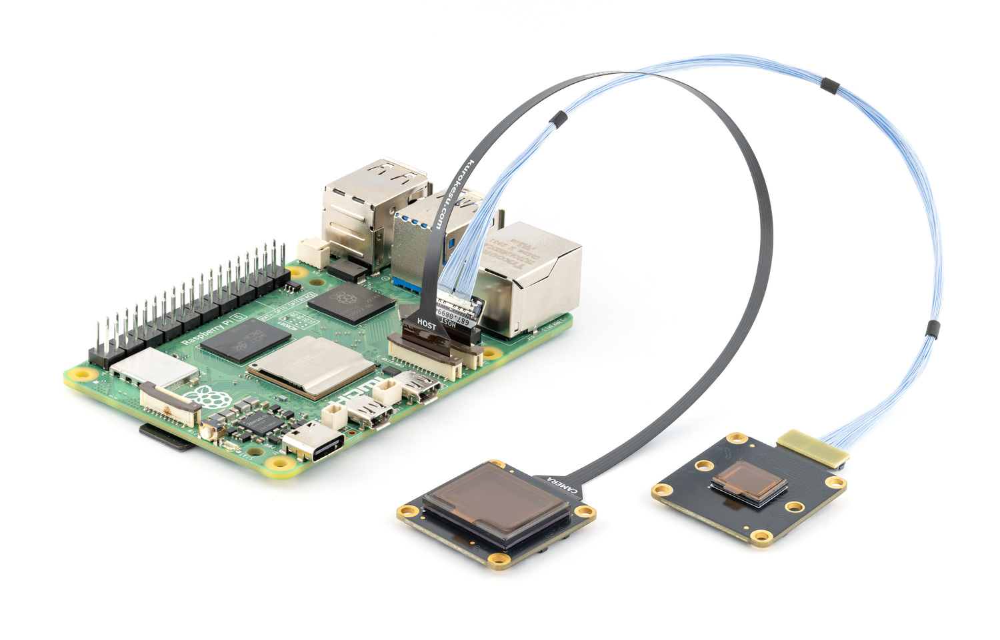

# IMX283 camera setup on Raspberry Pi

[](https://github.com/raspberrypi/linux/blob/rpi-6.18.y/drivers/media/i2c/imx283.c)
[](https://www.raspberrypi.com/software/operating-systems/)
[](https://github.com/raspberrypi/linux/tree/rpi-6.12.y)

Raspberry Pi setup for Sony IMX283, a 20 MP 1" CMOS sensor with 2.4 µm pixels. Raspberry Pi OS supports it out of the box.

- 4-lane MIPI CSI-2 (up to 1440 Mbps/lane)
- 10-bit and 12-bit RAW output
- 5472×3648 @ 18 fps (full resolution)
- 2736×1824 @ 37 fps (2×2 binning)
- 1824×1216 @ 50 fps (3×3 binning)



*IMX283 camera modules are available at [kurokesu.com](https://www.kurokesu.com/item/283C-CSI)*

## Setup

Connect camera to CSI port with Pi powered off.

> [!WARNING]
> IMX283 needs 4-lane MIPI CSI-2 port. Check that your board and chosen port provide 4 lanes.

Update OS and reboot:

```bash
sudo apt update && sudo apt full-upgrade -y
sudo reboot
```

Edit boot configuration:

```bash
sudo nano /boot/firmware/config.txt
```

Make two changes:

1. Find `camera_auto_detect` near the top and set it to `0`:

```ini
camera_auto_detect=0
```

2. Add `dtoverlay=imx283` under the `[all]` section at the bottom of the file:

```ini
[all]
dtoverlay=imx283
```

*If camera is connected to cam0 port, use `dtoverlay=imx283,cam0` instead. See [cam0](#cam0).*

Save and exit.

`config.txt` changes take effect after reboot:

```bash
sudo reboot
```

Verify camera is detected:

```bash
rpicam-hello --list-cameras
```

Expected output:

```
Available cameras
-----------------
0 : imx283 [5472x3648 12-bit RGGB] (/base/axi/pcie@1000120000/rp1/i2c@70000/imx283@1a)
    Modes: 'SRGGB10_CSI2P' : 5472x3648 [18.79 fps - (0, 0)/5472x3648 crop]
           'SRGGB12_CSI2P' : 1824x1216 [50.91 fps - (0, 0)/5472x3648 crop]
                             2736x1824 [37.12 fps - (0, 0)/5472x3648 crop]
                             5472x3648 [18.79 fps - (0, 0)/5472x3648 crop]
```

Start live preview:

```bash
rpicam-hello -t 0
```

On headless systems, capture a still image instead:

```bash
rpicam-still -o test.jpg
```

## dtoverlay options

`imx283` overlay supports comma-separated options to override defaults:

| option | description | default |
|--------|-------------|---------|
| [`cam0`](#cam0) | Use cam0 port instead of cam1 | cam1 |
| [`clock-frequency=<Hz>`](#clock-frequency) | Sensor input clock (Hz) | 24000000 |
| [`link-frequency=<Hz>`](#link-frequency) | MIPI link frequency (Hz) | 720000000 |
| `rotation=<deg>` | Sensor mounting rotation | 180 |
| `orientation=<n>` | Camera orientation (0 front, 1 back, 2 external) | 2 |
| `media-controller=0` | Use legacy unicam driver | on |

### cam0

If camera is connected to cam0 port, append `,cam0`:

```ini
dtoverlay=imx283,cam0
```

### clock-frequency

Kurokesu IMX283 modules carry a 24 MHz oscillator, which matches overlay default. Driver also supports 6, 12 and 18 MHz.

### link-frequency

Supported link frequencies: 720 MHz (default) and 360 MHz.

To set link frequency to 360 MHz, append `,link-frequency=360000000`:

```ini
dtoverlay=imx283,link-frequency=360000000
```

## Output formats

| Link frequency | Data rate / lane | Lanes | Bit depth | Width | Height | Max FPS |
|---|---|---|---|---|---|---|
| **5472×3648 (full resolution)** | | | | | | |
| 720 MHz | 1440 Mbps | 4 | 10-bit | 5472 | 3648 | 18 fps |
| 720 MHz | 1440 Mbps | 4 | 12-bit | 5472 | 3648 | 18 fps |
| 360 MHz | 720 Mbps | 4 | 10-bit | 5472 | 3648 | 10 fps |
| 360 MHz | 720 Mbps | 4 | 12-bit | 5472 | 3648 | 10 fps |
| **2736×1824 (2×2 binning)** | | | | | | |
| 720 MHz | 1440 Mbps | 4 | 12-bit | 2736 | 1824 | 37 fps |
| 360 MHz | 720 Mbps | 4 | 12-bit | 2736 | 1824 | 19 fps |
| **1824×1216 (3×3 binning)** | | | | | | |
| 720 MHz | 1440 Mbps | 4 | 12-bit | 1824 | 1216 | 50 fps |
| 360 MHz | 720 Mbps | 4 | 12-bit | 1824 | 1216 | 30 fps |

> [!TIP]
> Options can be combined. Example (cam0, 360 MHz):
>
> ```ini
> dtoverlay=imx283,cam0,link-frequency=360000000
> ```

## FAQ

### Why does rpicam-hello say "No cameras available!"?

Check [Setup](#setup) steps first: `camera_auto_detect=0`, overlay line under `[all]`, 4-lane port and `cam0` option matching the port in use. Then check kernel log:

```bash
dmesg | grep imx283
```

`failed to read chip id` means sensor does not answer on I2C:

```
imx283 0-001a: Error reading reg 0x3000: -121
imx283 0-001a: failed to read chip id b, with error -121
imx283 0-001a: probe with driver imx283 failed with error -121
```

Check camera port and cable seating, with Pi powered off.

`Could not create camera helper for imx283` means libcamera predates IMX283 support. Update OS as shown in [Setup](#setup).

## Credits

- [Will Whang](https://github.com/will127534) for driver and [libcamera helper](https://github.com/raspberrypi/libcamera/commit/69b702d183bb2ea2ce3ba40fcde8d5f5cf80abcc)
- Umang Jain and [Kieran Bingham](https://github.com/kbingham) (Ideas on Board) for [mainline imx283 driver](https://github.com/raspberrypi/linux/blob/rpi-6.18.y/drivers/media/i2c/imx283.c)
- [Naushir Patuck](https://github.com/naushir) (Raspberry Pi) for [tuning](https://github.com/raspberrypi/libcamera/commit/eb9bb35d80f2a973606b844f71be025e41e2a1f7)
